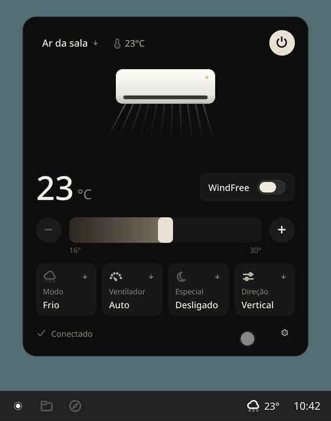
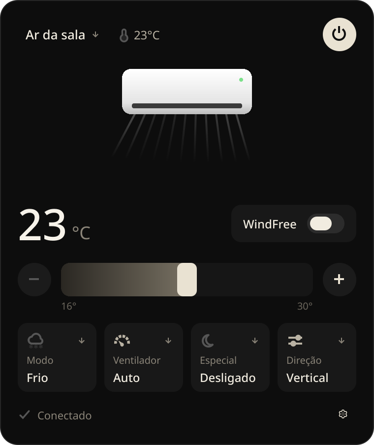
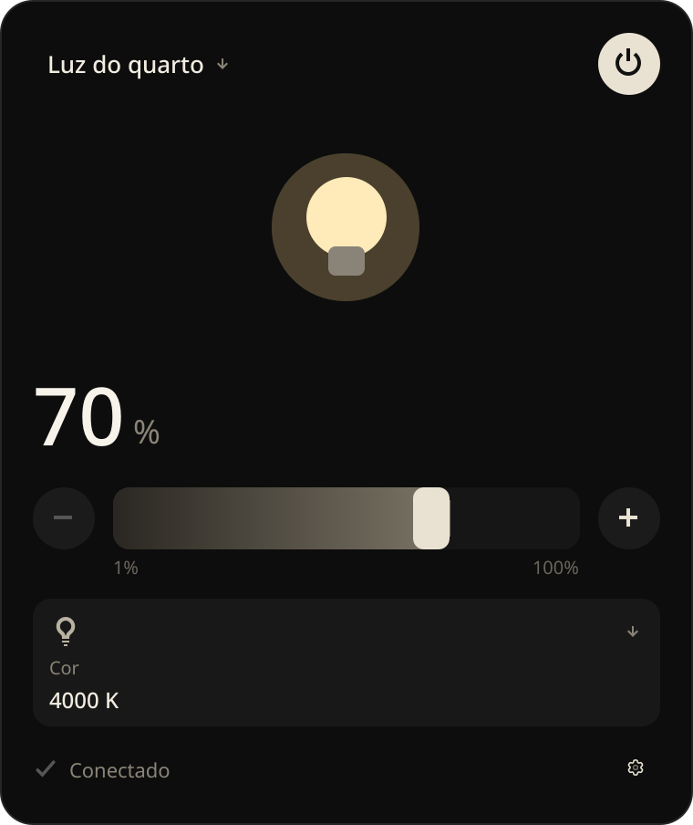
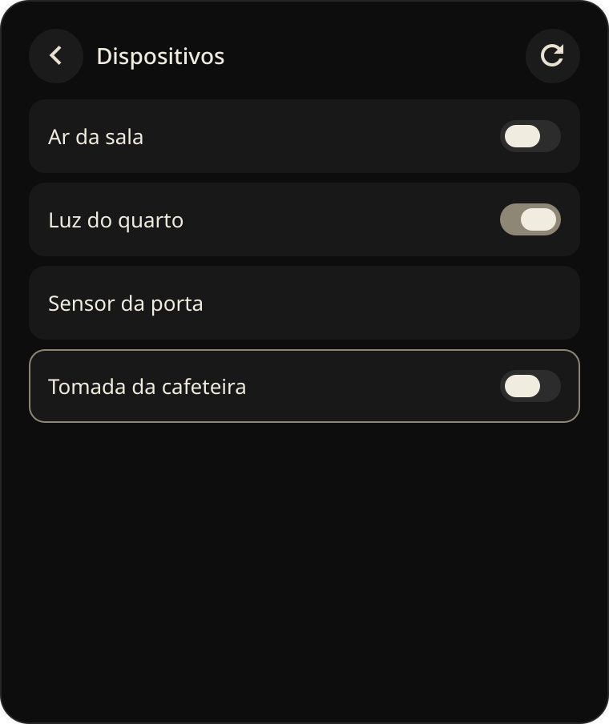
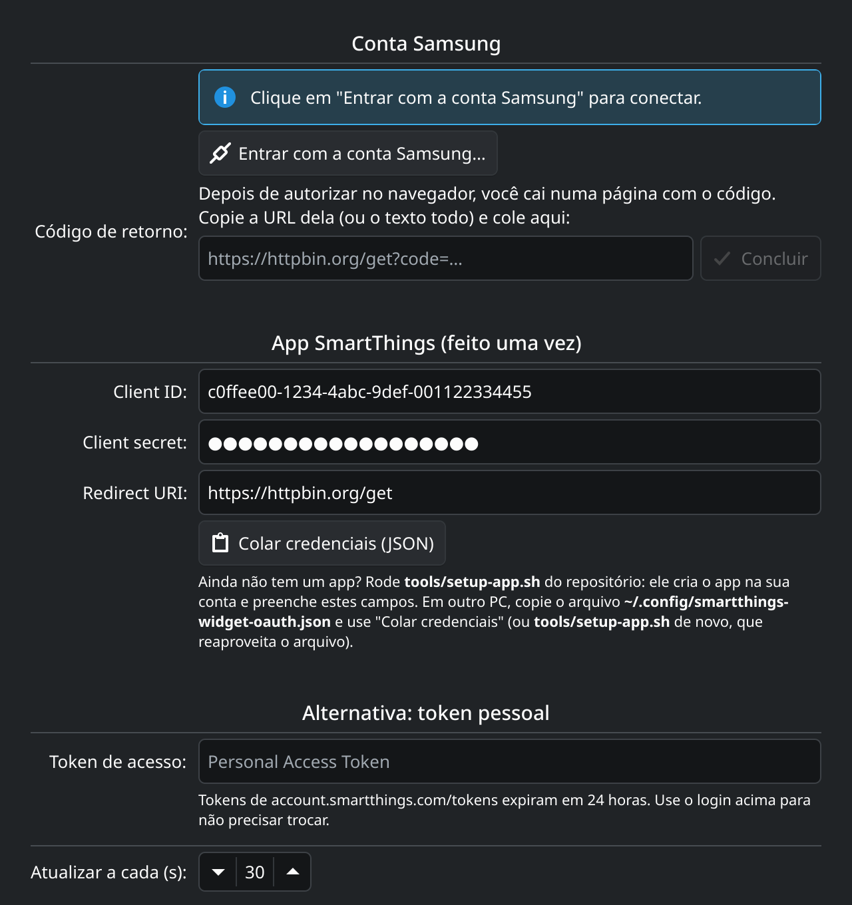
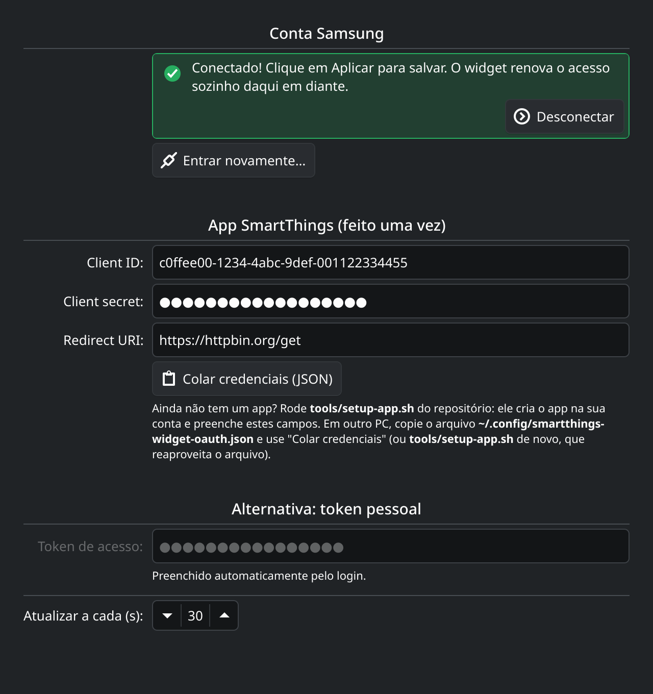

# SmartThings para KDE Plasma

Widget do painel do KDE Plasma 6 para controlar dispositivos Samsung SmartThings: ar-condicionado, luzes, tomadas, TVs e o que mais estiver na sua conta.

<p align="center">
  
</p>

<p align="center">
  
  
  
</p>

## O que ele faz

- **Ar-condicionado:** temperatura, modo (frio, seco, ventilar…), ventilador, direção do vento e modos especiais como WindFree.
- **Luzes:** liga/desliga, brilho e temperatura de cor.
- **Som:** volume.
- **Qualquer dispositivo com liga/desliga:** tomadas, TVs, etc.
- **Painel:**  mostra o valor principal do dispositivo escolhido (ex.: `23°`). Clique para abrir o controle e use o botão do meio para ligar/desligar.
- **Login com a conta Samsung:** o acesso é renovado sozinho, sem precisar trocar o token a cada 24 horas.

## Requisitos

- KDE Plasma 6.0 ou mais novo, em qualquer distro (Arch, Fedora, openSUSE, Kubuntu, KDE neon…). O widget é só QML e não precisa compilar.
- Conta Samsung com dispositivos no SmartThings.
- Para criar o app de login (uma vez só): Node.js e Python 3.

## Instalação

```sh
git clone https://github.com/Glerme/smart-widget-kde.git
cd smart-widget-kde
./tools/install.sh
```

Depois clique com o botão direito no painel → **Adicionar widgets** → **SmartThings**.

Se baixou o `.plasmoid` das [releases](https://github.com/Glerme/smart-widget-kde/releases), instale com:

```sh
kpackagetool6 -t Plasma/Applet -i smartthings-*.plasmoid
```

## Conectando a conta Samsung

Desde dezembro de 2024, os tokens pessoais do SmartThings expiram em 24 horas. Para o widget funcionar sem manutenção, ele usa login OAuth, e o OAuth exige um "app" registrado na sua própria conta SmartThings. O script abaixo cria esse app.

### 1. Criar o app (uma vez por conta)

Com o widget já no painel:

```sh
./tools/setup-app.sh
```

O script usa a [CLI oficial do SmartThings](https://github.com/SmartThingsCommunity/smartthings-cli):

1. A CLI abre o navegador para você entrar na conta Samsung.
2. Ela cria um app OAuth com permissão para ver e controlar dispositivos (`r:devices:*`, `x:devices:*`).
3. O script salva o Client ID e o secret em `~/.config/smartthings-widget-oauth.json`. **Guarde esse arquivo:** a SmartThings não mostra o secret de novo.
4. Por fim, preenche essas credenciais nas configurações do widget.

### 2. Entrar

1. Abra as configurações do widget e clique em **Entrar com a conta Samsung…**.
2. Autorize no navegador e escolha o local dos seus dispositivos.
3. Você cai numa página do `httpbin.org` que mostra o código. Copie a URL da barra de endereço e cole no campo **Código de retorno**. O login conclui sozinho.
4. Clique em **Aplicar**.

<p align="center">
  
  
</p>

> **Por que o httpbin.org?** A SmartThings não aceita redirecionar o login para `localhost`, então o widget não consegue capturar o código sozinho. O httpbin só mostra na tela o endereço que recebeu, e o código vale por poucos minutos e só funciona junto com o seu secret. Se preferir outra página, mude a *Redirect URI* no app e no widget.

Pronto. O widget renova o acesso a cada 12 horas. Você só precisa entrar de novo se ele ficar mais de 29 dias sem conseguir renovar (por exemplo, o PC desligado esse tempo todo).

### Em outros PCs

Não crie outro app. Leve o arquivo de credenciais junto:

1. Copie `~/.config/smartthings-widget-oauth.json` para o mesmo caminho no outro PC.
2. Instale o widget e rode `./tools/setup-app.sh`. Ele vê que o arquivo existe e só preenche o widget. Outra opção é copiar o conteúdo do arquivo e usar **Colar credenciais (JSON)** nas configurações.
3. Faça o **Entrar com a conta Samsung…** nesse PC também.

Cada PC precisa do próprio login. O token de renovação muda a cada uso, então dois PCs com os mesmos tokens derrubariam um ao outro.

### Alternativa: token pessoal

Também dá para colar um token de [account.smartthings.com/tokens](https://account.smartthings.com/tokens) no campo **Token de acesso**, mas ele expira em 24 horas.

## Desenvolvimento

```
package/                 o widget (o que vai no .plasmoid)
  contents/ui/
    main.qml             integração com o Plasma (painel, popup, configuração)
    Backend.qml          API do SmartThings, estado e renovação do token (não depende do Plasma)
    oauth.js             login OAuth: URL de autorização, troca do código, credenciais
    FullView.qml         popup de controle
    CompactView.qml      ícone e valor no painel
    configGeneral.qml    tela de configurações
tools/
  install.sh             instala ou atualiza o widget
  setup-app.sh           cria o app OAuth e configura o widget
  build.sh               gera dist/smartthings-<versão>.plasmoid
test/
  mock_server.py         API falsa do SmartThings (dispositivos de exemplo)
  harness.qml            exercita o popup contra a API falsa e tira capturas
  config-harness.qml     renderiza a tela de configurações
  demo.qml               roteiro do GIF animado do README
  run.sh                 roda tudo; com --docs atualiza docs/screenshots e docs/demo.gif
```

Para testar sem conta nem dispositivos:

```sh
./test/run.sh            # capturas em test/out
./test/run.sh --docs     # atualiza as imagens e o GIF deste README (o GIF precisa do ffmpeg)
```

Para aplicar mudanças no widget instalado:

```sh
./tools/install.sh && systemctl --user restart plasma-plasmashell
```

> Em várias distros, `/usr/bin/qml` é o runtime do Qt 5. O `test/run.sh` procura o do Qt 6 sozinho (em geral `/usr/lib/qt6/bin/qml`).

## Licença

[MIT](LICENSE)
